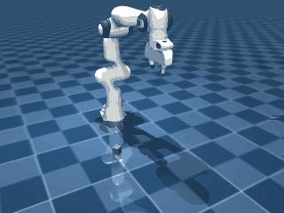
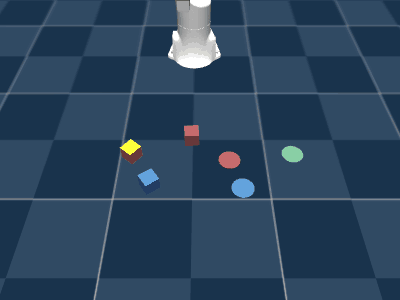
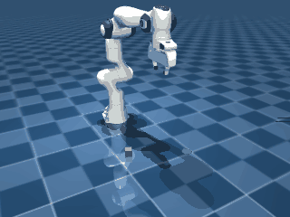
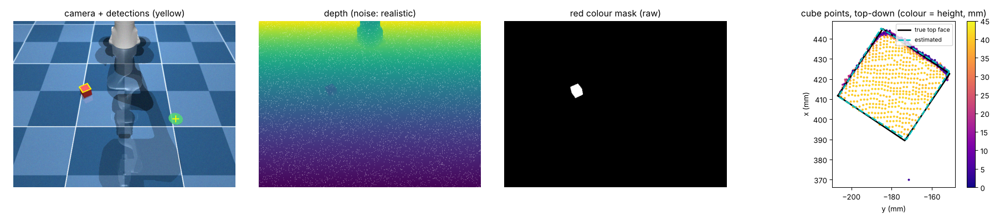
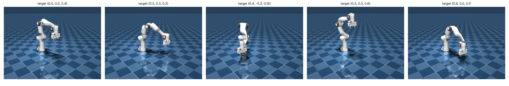

# Adaptive Robot Intelligence

An autonomous robotic manipulation system built in simulation, from first principles up:
kinematics and control → motion planning → perception → imitation learning →
reinforcement learning → language-conditioned behaviour.

**Minimum viable system (target):** a simulated Franka Panda picks a cube from a random
position using only camera input and places it in a target zone. Scripted, imitation-learned
and RL policies are compared on a fixed, seeded evaluation set.

## Status

| Milestone | Status | Evidence |
|---|---|---|
| M0 Environment setup | ✅ Implemented | `scripts/view_panda.py` |
| M1 Model inspection | ✅ Implemented | `scripts/inspect_model.py` |
| M2 Joint control | 🧪 Tested | `tests/test_control.py`, step-response plots |
| M3 Forward kinematics (from scratch, DH) | 🧪 Tested | matches MuJoCo to 1e-9 m over 200 random configs |
| M4 Inverse kinematics (damped least squares) | 🧪 Tested | 100% success on 100 random reachable targets, mean error 0.05 mm |
| M5 Pick-and-place scene + Cartesian controller | 🧪 Tested | `tests/test_pick_place.py` |
| M6 Minimum-jerk trajectories | 🧪 Tested | `tests/test_trajectory.py` |
| M7 Scripted pick-and-place baseline | 🧪 Tested | 100/100 seeded episodes, stress-tested in 9 configurations |
| M9 Seeded evaluation with confidence intervals | ✅ Implemented | `scripts/evaluate_scripted.py` |
| M8 Collision-aware planning (RRT-Connect, 7-DoF posture search) | 🧪 Tested | 96% clean success over a random wall vs 60% for a hand-written heuristic |
| M10 RGB-D camera model | 🧪 Tested | back-projected renderer depth matches geometry to < 0.1 mm |
| M11 Cube and target localization | 🧪 Tested | cube ~0.3-0.6 mm, target ~1 mm median error |
| M12 Vision-driven pick-and-place | 🧪 Tested | same success as ground truth under 3 noise levels |
| M13 Demonstrations + state-feedback expert | 🧪 Tested | exact replay; expert 100% nominal and with a moved cube |
| M14 Behaviour cloning + DAgger (PyTorch) | 🧪 Tested | 100% nominal; 99% with the cube moved mid-episode |
| M15 Image-based policy (own CNN, teacher-student) | 🧪 Tested at CPU scale | 43% from two 64×64 cameras; grasps 95/100, placing is the weak point |
| M15 at full scale; LeRobot ACT | 🟨 Scripts + Colab notebook ready | ACT smoke-tested only; no trained ACT policy yet |
| M16 Gymnasium environments | 🧪 Tested | `check_env` passes; shaping reward telescopes |
| M17 PPO from scratch | 🧪 Tested | verified on Pendulum-v1; reach 100% (3 seeds); pick-and-place from scratch 0% |
| M18 Residual RL on the cloned policy | 🧪 Tested | 66% → 92-93% (2 seeds) |
| M19 Instruction following (parser + skill; end-to-end language policy) | 🧪 Tested | 149/150 modular; end-to-end 108, 144, 146 of 150 over three seeds |
| M20 Task planner: validation, monitoring, recovery | 🧪 Tested | 95% of two-step tasks with injected faults (35-45% without monitoring) |
| M21 Vision-language-action fine-tuning | ⬜ Not attempted | needs a GPU and pretrained weights |
| Stage 7 Benchmark, report | ⬜ Planned | see `docs/roadmap.md` |

✅ Implemented = code exists and runs · 🧪 Tested = verified by automated tests or measured results

## Results so far

### Scripted pick-and-place (Stage 2)


100 seeded episodes per row, cube pose from simulator ground truth. Full table and analysis: [`docs/results_stage2.md`](docs/results_stage2.md).

| Condition | Success (95% CI) | Main failure |
|---|---|---|
| Default (μ = 1.0, 0.25 m/s) | **100%** (96.3-100) | none |
| Slippery cube (μ = 0.5) | **0%** | grasp fails: only ~1 N per finger |
| Fast (1.0 m/s) | 89% (81.4-93.7) | cube dropped in transport |
| Fast, gripper stiffness ×10 | 100% (96.3-100) | none (placement error 6 mm vs 2 mm) |

Debugging these runs uncovered four simulation issues: friction creep, a friction parameter
that had no effect, a weak gripper, and an underdamped finger servo. All four are diagnosed in
[`docs/devlog.md`](docs/devlog.md).

### Imitation learning (Stage 4)



*A learned policy (neural network, 20 Hz). One second in, the cube is moved; the policy re-targets.
The scripted Stage 2 policy fails this test every time.*

100 evaluation episodes per cell. Full analysis, including a negative result: [`docs/results_stage4.md`](docs/results_stage4.md).

| Policy | Nominal | Cube moved mid-episode |
|---|---|---|
| Scripted expert (clock-driven) | 100% | 0% |
| Reactive expert (state feedback) | 100% | 100% |
| Cloned from scripted expert, 500 demos | 18% | not run |
| Cloned from reactive expert, 500 demos | 100% | 68% |
| + DAgger | 97% | **99%** |

The largest effect came from the choice of expert, not the network: a memoryless policy cannot
clone a clock-driven expert (18%) but clones a state-feedback one (100%) with identical training.

### Reinforcement learning (Stage 5)


PPO written from scratch, checked on a standard benchmark first. 100 evaluation episodes per cell.
Full analysis: [`docs/results_stage5.md`](docs/results_stage5.md).

| Policy (from 100 demonstrations) | Nominal | Cube moved |
|---|---|---|
| Cloned policy | 66% | 43% |
| Cloned policy + exploration noise, no learning | 79% | 51% |
| Cloned policy + residual RL | 92-93% (2 seeds) | 64-73% |

- Reaching a point is learned from scratch in ~150k steps and matches a proportional controller.
- Pick-and-place from scratch did not work (0% in 600k steps).
- Half of the residual policy's gain is exploration noise freeing the clone from small stalls;
  the noise-only baseline is what separates that from learning.
- RL traded placement accuracy (4 mm → 10 mm) for speed and success, as the reward allowed.

### Language and task-level autonomy (Stage 6)



*"please move the yellow block onto the blue target. after that lift the blue cube and set it on
the green area". Twice during this run something is knocked out of place; the executor notices
from its own checks and redoes the step.*

Three cubes, three targets, instructions from a small generated grammar (45 words). Full
analysis, including a test split that turned out not to test anything and a conclusion from
one training seed that two more seeds overturned: [`docs/results_stage6.md`](docs/results_stage6.md).

| One instruction, 150 episodes | Seen sentences | New phrasing | New cube-target pairing | Total |
|---|---|---|---|---|
| Modular: GRU parser + Stage 4 learned skill | 100% | 98% | 100% | 149 |
| End-to-end language policy, 3 seeds | 88 / 100 / 100% | 80 / 100 / 96% | 48 / 88 / 96% | 108 / 144 / 146 |

| Two-step tasks, 100 episodes | No faults | Faults injected (60 of 100 tasks) |
|---|---|---|
| Learned skill, no monitoring | 92% | 45% |
| Learned skill + result checking and retries | 92% | 60% |
| Learned skill + checking + classical fallback skill | 95% | **95%** |

- The end-to-end policy (one network from sentence and scene to actions, trained by imitation
  only) can nearly match the modular system, but not reliably: identical code gives 108, 144 or
  146 depending on the seed, and 2 or 148 when its text encoder is pretrained.
- Each run's grounding is settled in the first training epoch and then kept. My first write-up,
  from one seed, claimed word order could not be learned from actions; two more seeds showed
  that was wrong. Both are in the results file.
- Because the policy's attention can be read out, every failure is attributed: wrong object
  (grounding) or right object and a missed grasp (motion).
- Checking results is what gives robustness; a learned skill retried outside its training
  conditions keeps failing, so retries go to a classical skill.
- The plan is validated before the robot moves: 5 of 100 tasks were refused, including both
  that had been misread. 95% is therefore the ceiling in the second table.
- VLA fine-tuning (M21) was not attempted.

### Learning from images (M15, CPU-scale)



*This policy sees only two 64×64 camera images and its own gripper pose.*

| Policy | Input | Nominal | Cube moved |
|---|---|---|---|
| Stage 4 clone, 500 demos | simulator state | 100% | 68% |
| Image student, 200 demos, no GPU | 2 cameras | 43% | 4% |

It lifts the cube in 95 of 100 episodes and mostly fails at placing; it does not yet adapt to a
moved cube. Trained on 2 CPU cores; [`notebooks/m15_vision_policy_colab.ipynb`](notebooks/m15_vision_policy_colab.ipynb)
runs the same scripts on a GPU. Details, including how the Stage 4 DAgger puzzle was resolved:
[`docs/results_m15.md`](docs/results_m15.md).

### Perception (Stage 3)



The robot localizes the cube and target from one RGB-D image (colour segmentation + depth
back-projection). 100 seeded episodes per cell. Full analysis: [`docs/results_stage3.md`](docs/results_stage3.md).

| Scene / policy | Ground truth | Vision, no noise | Vision, realistic noise | Vision, poor noise |
|---|---|---|---|---|
| Open table / scripted | 100% | 100% | 100% | 100% |
| Wall / planned | 96% | 96% | 98% | 98% |

Making localization robust to depth noise took a bias fix: choosing the cube's top face as "the
highest points" biased its height by +6.8 mm under noise. A mode-based estimate with depth
filtering cut the xy error 10× (7.8 → 0.8 mm). See [`docs/devlog.md`](docs/devlog.md).

### Collision-aware planning (M8)


A wall of random height (18-30 cm) between cube and target, 100 seeded episodes. *Clean* = placed with zero wall contact.
Full analysis: [`docs/results_m8.md`](docs/results_m8.md).

| Policy | Clean success (95% CI) | Episodes touching wall |
|---|---|---|
| Stage 2 scripted (naive) | 0% | 100 |
| Hand-written "lift above the wall" | 60% (50-69) | 40 |
| **Planned** (RRT-Connect + posture search) | **96%** (90-98) | **0** |

The heuristic's main failure was the **elbow** hitting the wall while grasping cubes near
it. The planner uses the Panda's 7th joint to choose an arm posture that stays clear.

### Reaching (Stage 1)

**Reaching Cartesian targets** (gripper pointing down, IK solution executed in physics for 1.5 s):

| Target (m) | IK iterations | IK error | Error in sim (no gravity comp) | Error in sim (gravity comp) |
|---|---|---|---|---|
| (0.5, 0.0, 0.4) | 4 | 0.06 mm | 6.1 mm | 0.06 mm |
| (0.5, 0.3, 0.2) | 5 | 0.09 mm | 7.7 mm | 0.09 mm |
| (0.4, −0.3, 0.15) | 6 | 0.09 mm | 6.5 mm | 0.09 mm |
| (0.3, 0.0, 0.6) | 9 | 0.10 mm | 2.9 mm | 0.10 mm |
| (0.6, 0.0, 0.1) | 7 | 0.03 mm | 8.8 mm | 0.03 mm |

The IK math is accurate; without gravity compensation, the PD servos sag under the arm's
weight by several millimetres. Adding a gravity feedforward torque removes that error.



## Quickstart (macOS / Linux)

```bash
git clone https://github.com/google-deepmind/mujoco_menagerie.git   # next to this repo
cd adaptive-robot-intelligence
python3.12 -m venv .venv && source .venv/bin/activate
pip install -e ".[dev]"

python scripts/inspect_model.py                   # what the robot is made of
mjpython scripts/view_panda.py                    # interactive viewer (use `python` on Linux)
python scripts/joint_step_response.py             # control experiment -> outputs/
python scripts/ik_demo.py --gravity-comp          # IK + execution -> outputs/
python scripts/pick_place_demo.py --seed 3        # one episode -> GIF + plots in outputs/
python scripts/evaluate_scripted.py               # 100-episode evaluation (~2-6 min)
python scripts/pick_place_demo.py --wall --policy planned --seed 1   # planning demo
python scripts/evaluate_wall.py --policy planned  # naive vs heuristic vs planned
python scripts/perception_demo.py --seed 3        # what the camera sees -> outputs/
python scripts/evaluate_vision.py --scene wall --noise realistic   # vision-driven robot
python scripts/collect_demos.py --expert reactive --n 500          # demonstrations -> data/
python scripts/train_bc.py --demos data/demos_reactive.npz --dagger-iters 3 --name my_policy
python scripts/evaluate_bc.py --disturb reactive scripted outputs/models/bc_dagger.pt
python scripts/bc_demo.py outputs/models/bc_dagger.pt --seed 3 --disturb
python scripts/train_vision.py --demos 200 --epochs 18 --name my_vision   # image policy (CPU ok)
python scripts/train_rl.py reach --steps 200000   # RL from scratch (~4 min on 2 cores)
python scripts/train_rl.py residual --base outputs/models/bc_reactive_100.pt --steps 400000
python scripts/evaluate_bc.py --joint-interp --disturb outputs/models/rl_residual.pt
python scripts/train_language.py parser           # instruction parsers (seconds)
python scripts/train_language.py policy --seed 2  # language-conditioned policy (~10 min on 2 cores)
python scripts/evaluate_language.py m19           # one instruction per episode, 3 systems
python scripts/evaluate_language.py m20           # two-step tasks, with and without faults
python scripts/language_demo.py "put the red cube on the green target, then move the yellow cube to the blue target"
python scripts/language_demo.py --seed 7 --faults # recovery demo -> GIF
pytest                                            # 149 tests
```

If Menagerie is somewhere else: `export ARI_MENAGERIE=/path/to/mujoco_menagerie`.
On Linux without a display (servers, Colab), rendering uses `MUJOCO_GL=egl`; the package sets
this automatically if you import `ari` before `mujoco`.

## Repository layout

```
src/ari/
  robot/      model loading, transforms, forward kinematics, Jacobian, IK
  control/    joint-space PD control, gravity compensation, Cartesian (IK-based) controller
  planning/   trajectories, collision checking, RRT-Connect, redundancy resolution, task planner
  envs/       pick-and-place scene with seeded randomization; multi-object scene; Gymnasium wrappers
  language/   instruction grammar, parsers, language-conditioned policy, evaluation
  rl/         PPO, task builders, residual policy
  learning/   observation/action spaces, demonstrations, behaviour cloning, DAgger, evaluation
  perception/ RGB-D camera model, colour + depth localization, noise model, vision-driven policy wrapper
  skills/     scripted, planned and reactive (state-feedback) pick-and-place, episode runner
scripts/      runnable experiments
tests/        automated checks (kinematics vs MuJoCo, IK success rate, control behaviour)
docs/         roadmap, development log, concept notes
outputs/      generated plots and images
```

## Design decisions

- **MuJoCo + Franka Panda (MuJoCo Menagerie).** Accurate contact, fast on CPU, the most-studied arm in manipulation research.
- **Kinematics written from Franka's DH parameters, not read from MuJoCo.** Agreement between two independent robot descriptions is a real check, not a tautology.
- **ROS 2 deferred.** No engineering need inside a single-process simulation; it may be added later as an integration layer.
