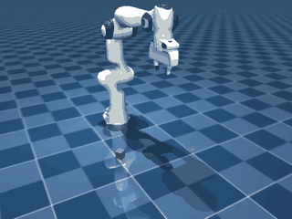
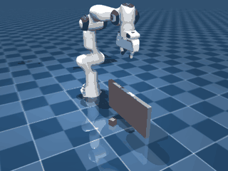

# Adaptive Robot Intelligence

An autonomous robotic manipulation system built in simulation, from first principles up:
kinematics and control → motion planning → perception → imitation learning →
reinforcement learning → language-conditioned behaviour.

**Minimum viable system (target):** a simulated Franka Panda picks a cube from a random
position using only camera input and places it in a target zone. Scripted, imitation-learned
and RL policies are compared on a fixed, seeded evaluation set.

## Status

| Milestone | Status | Evidence |
|---|---|---|
| M0 Environment setup | ✅ Implemented | `scripts/view_panda.py` |
| M1 Model inspection | ✅ Implemented | `scripts/inspect_model.py` |
| M2 Joint control | 🧪 Tested | `tests/test_control.py`, step-response plots |
| M3 Forward kinematics (from scratch, DH) | 🧪 Tested | matches MuJoCo to 1e-9 m over 200 random configs |
| M4 Inverse kinematics (damped least squares) | 🧪 Tested | 100% success on 100 random reachable targets, mean error 0.05 mm |
| M5 Pick-and-place scene + Cartesian controller | 🧪 Tested | `tests/test_pick_place.py` |
| M6 Minimum-jerk trajectories | 🧪 Tested | `tests/test_trajectory.py` |
| M7 Scripted pick-and-place baseline | 🧪 Tested | 100/100 seeded episodes, stress-tested in 9 configurations |
| M9 Seeded evaluation with confidence intervals | ✅ Implemented | `scripts/evaluate_scripted.py` |
| M8 Collision-aware planning (RRT-Connect, 7-DoF posture search) | 🧪 Tested | 96% clean success over a random wall vs 60% for a hand-written heuristic |
| Stage 3+ Perception, learning, … | ⬜ Planned | see `docs/roadmap.md` |

✅ Implemented = code exists and runs · 🧪 Tested = verified by automated tests or measured results

## Results so far

### Scripted pick-and-place (Stage 2)



100 seeded episodes per row, cube pose from simulator ground truth. Full table and analysis: [`docs/results_stage2.md`](docs/results_stage2.md).

| Condition | Success (95% CI) | Main failure |
|---|---|---|
| Default (μ = 1.0, 0.25 m/s) | **100%** (96.3-100) | none |
| Slippery cube (μ = 0.5) | **0%** | grasp fails: only ~1 N per finger |
| Fast (1.0 m/s) | 89% (81.4-93.7) | cube dropped in transport |
| Fast, gripper stiffness ×10 | 100% (96.3-100) | none (placement error 6 mm vs 2 mm) |

Debugging these runs uncovered four simulation issues: friction creep, a friction parameter
that had no effect, a weak gripper, and an underdamped finger servo. All four are diagnosed in
[`docs/devlog.md`](docs/devlog.md).

### Collision-aware planning (M8)



A wall of random height (18-30 cm) between cube and target, 100 seeded episodes. *Clean* = placed with zero wall contact.
Full analysis: [`docs/results_m8.md`](docs/results_m8.md).

| Policy | Clean success (95% CI) | Episodes touching wall |
|---|---|---|
| Stage 2 scripted (naive) | 0% | 100 |
| Hand-written "lift above the wall" | 60% (50-69) | 40 |
| **Planned** (RRT-Connect + posture search) | **96%** (90-98) | **0** |

The heuristic's main failure was the **elbow** hitting the wall while grasping cubes near
it. The planner uses the Panda's 7th joint to choose an arm posture that stays clear.

### Reaching (Stage 1)

**Reaching Cartesian targets** (gripper pointing down, IK solution executed in physics for 1.5 s):

| Target (m) | IK iterations | IK error | Error in sim (no gravity comp) | Error in sim (gravity comp) |
|---|---|---|---|---|
| (0.5, 0.0, 0.4) | 4 | 0.06 mm | 6.1 mm | 0.06 mm |
| (0.5, 0.3, 0.2) | 5 | 0.09 mm | 7.7 mm | 0.09 mm |
| (0.4, −0.3, 0.15) | 6 | 0.09 mm | 6.5 mm | 0.09 mm |
| (0.3, 0.0, 0.6) | 9 | 0.10 mm | 2.9 mm | 0.10 mm |
| (0.6, 0.0, 0.1) | 7 | 0.03 mm | 8.8 mm | 0.03 mm |

The IK math is accurate; without gravity compensation, the PD servos sag under the arm's
weight by several millimetres. Adding a gravity feedforward torque removes that error.


## Quickstart (macOS / Linux)

```bash
git clone https://github.com/google-deepmind/mujoco_menagerie.git   # next to this repo
cd adaptive-robot-intelligence
python3.12 -m venv .venv && source .venv/bin/activate
pip install -e ".[dev]"

python scripts/inspect_model.py                   # what the robot is made of
mjpython scripts/view_panda.py                    # interactive viewer (use `python` on Linux)
python scripts/joint_step_response.py             # control experiment -> outputs/
python scripts/ik_demo.py --gravity-comp          # IK + execution -> outputs/
python scripts/pick_place_demo.py --seed 3        # one episode -> GIF + plots in outputs/
python scripts/evaluate_scripted.py               # 100-episode evaluation (~2-6 min)
python scripts/pick_place_demo.py --wall --policy planned --seed 1   # planning demo
python scripts/evaluate_wall.py --policy planned  # naive vs heuristic vs planned
pytest                                            # 67 tests
```

If Menagerie is somewhere else: `export ARI_MENAGERIE=/path/to/mujoco_menagerie`.

## Repository layout

```
src/ari/
  robot/      model loading, transforms, forward kinematics, Jacobian, IK
  control/    joint-space PD control, gravity compensation, Cartesian (IK-based) controller
  planning/   trajectories, collision checking, RRT-Connect, redundancy resolution
  envs/       pick-and-place scene with seeded randomization
  skills/     scripted and planned pick-and-place policies, episode runner with failure attribution
scripts/      runnable experiments
tests/        automated checks (kinematics vs MuJoCo, IK success rate, control behaviour)
docs/         roadmap, development log, concept notes
outputs/      generated plots and images
```

## Design decisions

- **MuJoCo + Franka Panda (MuJoCo Menagerie).** Accurate contact, fast on CPU, the most-studied arm in manipulation research.
- **Kinematics written from Franka's DH parameters, not read from MuJoCo.** Agreement between two independent robot descriptions is a real check, not a tautology.
- **ROS 2 deferred.** No engineering need inside a single-process simulation; it may be added later as an integration layer.
