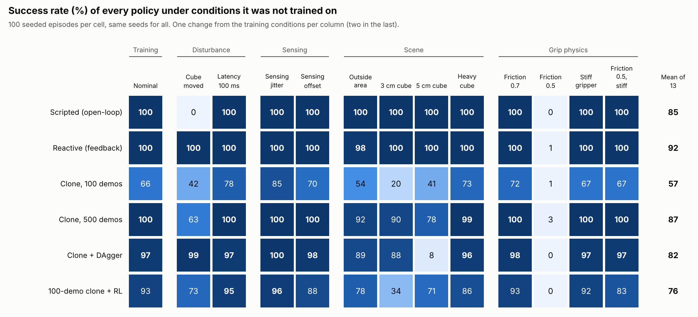

# Adaptive Robot Intelligence: final report

**Alper Sharip · November 2026 · [repository](https://github.com/alper-sharip/adaptive-robot-intelligence)**

A robot manipulation stack built in simulation (MuJoCo, Franka Panda) from the kinematics up,
on a laptop-class machine with no GPU and no robot hardware: control, motion planning,
perception, imitation learning, reinforcement learning, language-conditioned behaviour, and a
benchmark that compares everything on the same seeded episodes. Every number below comes
from a script in the repository and a fixed set of seeds. Where something did not work, or
where I first drew the wrong conclusion, that is reported too (section 4).



## 1. Headline results

| Capability | Result | Detail |
|---|---|---|
| Forward / inverse kinematics, written from the DH parameters | FK equals MuJoCo to 1e-9 m; IK 100/100 targets, mean error 0.05 mm | [concepts](concepts_m1_m4.md) |
| Scripted pick-and-place | 100/100 | [Stage 2](results_stage2.md) |
| Collision-aware planning over a random wall (RRT-Connect) | 96% with zero contacts; a hand-written heuristic gets 60% | [M8](results_m8.md) |
| Perception from one RGB-D image | cube located to 0.3-0.6 mm; vision-driven success equals ground truth | [Stage 3](results_stage3.md) |
| Behaviour cloning + DAgger | 97% nominal, 99% with the cube moved mid-episode | [Stage 4](results_stage4.md) |
| Policy from two 64×64 camera images | 43% (grasps in 95 of 100, placing is weak) | [M15](results_m15.md) |
| Reinforcement learning (own PPO), residual on a weak clone | 66% → 92-93% | [Stage 5](results_stage5.md) |
| Following a typed instruction among 3 cubes and 3 targets | 149/150 (parser + skill); 108-146/150 end-to-end over three seeds | [Stage 6](results_stage6.md) |
| Two-step tasks with injected faults | 95% with result checking and a fallback skill; 35-45% without checking | [Stage 6](results_stage6.md) |
| Generalization benchmark, 6 policies × 13 conditions × 100 episodes | no policy is best everywhere; each fails in its own way | [Stage 7](results_stage7.md) |
| Learned policies on camera input (cube tracked from images every 50 ms) | strong policies unchanged (within 1 of 300 paired episodes); the two weakest lose 18-19 of 300 | [camera loop](results_camera.md) |

The figure above is the last result and the best summary: six policies, each run on the same
100 episodes under 13 conditions they were not trained on. Each fails in its own place, and
two of the failures it found were flaws of mine, now fixed (section 3.1).

## 2. System

```mermaid
flowchart LR
    T["Typed instruction"] --> PR["Parser (GRU)"] --> PL["Task planner<br/>validate · monitor · retry"]
    CAM["RGB-D camera"] --> LOC["Colour + depth<br/>localization"]
    PL --> SK
    LOC -. "object poses, every 50 ms" .-> SK
    subgraph SK["Skills: one interface, 20 Hz"]
        direction TB
        S1["Scripted"]
        S2["Planned (RRT-Connect)"]
        S3["Reactive feedback"]
        S4["Cloned (BC, DAgger)"]
        S5["Clone + residual RL"]
        S6["Image policy (CNN)"]
    end
    SK --> EX["Action executor<br/>relative pose steps"] --> IK["Cartesian controller<br/>own IK, 100 Hz"] --> PD["Joint PD +<br/>gravity feedforward"] --> SIM["MuJoCo<br/>Franka Panda"]
    SIM --> CAM
```



Three design decisions hold the stack together:

1. **One action interface for every policy.** An action is a small step relative to the
   *measured* gripper pose plus a gripper command, at 20 Hz. The scripted expert, the learned
   policies and the RL policy all act through the same executor, so they can be compared, cloned
   from one another, and swapped inside the task planner.
2. **Seeded everything.** Episode `n` is the same scene on any machine. Evaluation seeds
   (0-99), demonstration seeds (10000+), DAgger seeds (20000+), RL seeds (30000+) and language
   seeds (40000+) never overlap. Success rates carry 95% Wilson intervals.
3. **Independent checks.** Kinematics are written from Franka's DH table and compared with
   MuJoCo; PPO was verified on a standard benchmark before it touched the robot; perception is
   scored against simulator truth it never sees.

## 3. What each stage established

**Control and kinematics.** A damped-least-squares IK with a null-space posture term, joint PD
with gravity feedforward, minimum-jerk trajectories. A bug worth remembering: using the damped
pseudo-inverse inside the null-space projector leaked posture motion into the task and stalled
IK at 0.5 mm; the projector needs the exact pseudo-inverse.

**Scripted manipulation and planning.** The baseline places 100/100, but stress tests found the
real limit: Menagerie's gripper squeezes with about 1 N per finger, so a cube with friction 0.5
cannot be held at all (0/100), and no policy can change that (section 3.1). With a wall in the
way, the scripted policy fails every episode; RRT-Connect with a 7-DoF posture search reaches
96% without touching it.

**Perception.** One RGB-D image, colour segmentation, depth back-projection. Taking "the highest
points" as the cube's top face biased its height by +6.8 mm under depth noise; a mode-based
estimate cut the position error from 7.8 mm to 0.8 mm.

**Imitation learning.** The choice of expert mattered more than the network: a memoryless
policy cloned from the clock-driven scripted expert reaches 18%; cloned from a state-feedback
expert with continuous rules, 100%, with identical training. DAgger then raised success with a
moved cube from 68% to 99%.

**Reinforcement learning.** PPO from scratch learns to reach (100%, three seeds) and equals a
three-line proportional controller. It does not learn pick-and-place from scratch (0%). As a
residual on a 66% clone it reaches 92-93%, and a noise-only baseline shows half of that gain is
exploration noise shaking the clone out of millimetre-scale stalls.

**Language and task-level autonomy.** A GRU parser plus the Stage 4 skill follows 149 of 150
instructions, including unseen phrasings and unseen cube-target pairs. One network from
sentence to actions, trained only by imitation, reaches 108, 144 or 146 depending on the
training seed: its grounding is fixed in the first epoch. A planner that validates the plan,
checks each result and retries turns 35-45% success under injected faults into 95%.

### 3.1 The benchmark

Six policies × 13 conditions × 100 seeded episodes ([Stage 7](results_stage7.md)). What it
showed that single-condition evaluation had not:

- **Hand-written policies fail completely on the one thing they assume** (the scripted policy
  when the cube moves: 0%; the reactive policy on a 5 cm cube, because the cube size was a
  constant in its code: 0%, now fixed, 100%). **Learned policies lose a little almost
  everywhere** instead.
- **A clone can beat its teacher.** On the 5 cm cube the 500-demo clone scored 78% against the
  unfixed teacher's 0%; with 5 mm sensing jitter the 500-demo clones stay at 100% while the teacher drops to 1%.
  DAgger, which copies the teacher more faithfully, loses the first of these advantages (8%).
- **Latency exposed a flaw in my own action interface, now fixed.** With 100 ms of delay every
  learned policy lost 26-44 points; at 200 ms even the hand-written ones collapsed. Actions
  were steps relative to the pose measured when the action is applied, so a late action landed
  on a pose the policy never saw. Actions are now anchored to the pose the policy observed:
  every policy is back at its undelayed level up to 200 ms, with no retraining (without delay
  the two interfaces give identical episodes). What remains is speed: beyond 200 ms the arm
  succeeds but slowly (30/30 at 500 ms given 90 s).
- **One column is a hardware limit.** At friction 0.5 every policy scores 0-3%, because the
  gripper's 1 N per finger cannot hold the cube; a stiffer gripper restores them.
- **More demonstrations generalized better than RL on fewer** (mean 86.5 for the 500-demo clone
  against 75.5 for the 100-demo clone with residual RL).
- **The 3 cm success tolerance hid a precision gap.** Re-scored at 1 cm, the RL policy falls
  from 93% to 35%; the scripted, reactive and 500-demo policies stay at 97-100%.

### 3.2 Closing the camera loop

After the benchmark, every single-object policy was given the cube and target from cameras
instead of the simulator, re-estimated every 50 ms: the wrist camera first, the fixed front
camera as backup ([details](results_camera.md)). On the same 300 seeded episodes per policy,
the scripted, reactive, 500-demo and DAgger policies score within one episode of their
simulator-state results. The two weakest policies lose 18 and 19 episodes (p < 0.01): they
hesitate at the grasp, which is the one view where the open fingers hide part of the cube from
the wrist camera and the estimate drifts 5-10 mm. The first full run also found a bug:
a cube only partly in the wrist camera's view gave estimates up to 20 mm off. It was fixed and
the run repeated.

## 4. What did not work, and what I got wrong

| Item | What happened | Status |
|---|---|---|
| Cloning the clock-driven expert | 18%: a policy without memory cannot reproduce behaviour that depends on elapsed time | explained; led to the reactive expert |
| DAgger starting from 100 demonstrations | made the policy worse (71% → 39%) | explained: too few epochs on the grown dataset; fixed, 70% |
| DAgger on the image policy | success collapses during fine-tuning | **open** |
| PPO pick-and-place from scratch | 0% after 600k and 500k steps; does not even approach the cube | **open**; one reward flaw found and fixed, not the cause |
| Pretrained text encoder in the language policy | 2/150 on one seed, 148/150 on another | partly explained (early commitment of the attention); a lower learning rate fixed the one case tried |
| First held-out language split | both parsers 48.2% | explained: the split made word order irrelevant in training; redesigned |
| "Word order cannot be learned from actions" | concluded from one seed; two more seeds learn it | **my error**, corrected in the same stage |
| Actions relative to the pose at application time | a design choice from Stage 4 that made every policy fragile to latency | **my design flaw**, found by the benchmark; **fixed** (actions anchored to the observed pose), verified on the benchmark |
| Trusting a camera that sees only part of the cube | estimates up to 20 mm off; one failed episode | **my oversight**, found by the first full camera run; fixed, and the run repeated |
| Cube size as a constant in the reactive policy | 0% on a 5 cm cube | **my oversight**, found by the benchmark; **fixed**, 100% |
| Step-response rise time | first attributed to torque saturation | **my error**; an experiment showed it is set by kd/kp |
| Vision-language-action fine-tuning (M21) | not attempted: needs a GPU and pretrained weights | not done |
| Full-scale image policy, LeRobot ACT | scripts and a Colab notebook exist; ACT is smoke-tested only | not done |

## 5. Lessons I would carry to a real robot

1. **Measure the hardware limit before blaming the policy.** A 1 N gripper decided more
   outcomes than any algorithm in this project.
2. **Feedback beats memory.** Every large robustness gain came from re-reading the scene:
   the reactive expert, DAgger, post-condition checks in the planner.
3. **Baselines that isolate the cause.** Noise-only next to RL; bag-of-words next to the GRU;
   "told the right objects" next to the language policy. Without them the wrong mechanism gets
   the credit.
4. **One training run is one sample.** The language policy's 108 and 146 came from the same
   code.
5. **A test must be solvable from the training data.** Otherwise it measures the split.
6. **Small imitation errors become large task failures at contact.** A 1.4× difference in
   action error separated 0-2 from 19-23 failed grasps.
7. **Know where a learned component should not be trusted**, and put a classical one behind it.

## 6. Limitations

- **Simulation only.** Nothing here has touched hardware. Contact, friction, sensing and
  latency are modelled, and the benchmark shows the policies are sensitive to exactly the
  things simulation tends to get wrong.
- **One object type.** Cubes on an empty table. No clutter, no occlusion, no deformables.
- **Perception is simplified.** All single-object policies can now run on camera input
  (tracked every step), but the cameras are simulated: perfectly calibrated, no blur or
  distortion, a red cube on a plain table found by colour. The language and multi-object layer
  (Stage 6) and the task monitor still use simulator positions.
- **Small scale.** 2 CPU cores; networks of a few hundred thousand parameters; 100-500
  demonstrations; one to three training seeds per result.
- **A generated language.** 45 words. Not open-ended English.
- **Monitoring uses simulator truth.**

## 7. Next steps, in order of value

1. **Perception for the multi-object and language layer:** detect all three cubes and targets by
   colour, so Stage 6 and its task monitor run on cameras too (the single-object policies
   already do: [camera loop](results_camera.md)).
2. **Latency compensation:** predict where the arm is now from the commands still in flight,
   so the fixed interface stops slowing the arm down beyond 200 ms; and re-collect
   demonstrations from the fixed reactive policy with randomized cube sizes.
3. **GPU-scale image policy** (the Colab notebook), then DAgger on it once the collapse is
   understood.
4. **VLA fine-tuning** with the Stage 6 evaluation as the benchmark and parser + skill as the
   baseline to beat.
5. **Hardware:** a ROS 2 wrapper around the action interface, system identification of a real
   gripper, and the same seeded evaluation protocol on a physical table.

## 8. Reproducing

```bash
pip install -e ".[dev]"            # Python 3.10+, MuJoCo, PyTorch; no GPU needed (MuJoCo Menagerie cloned next to the repo)
pytest                              # 177 tests, about 2 min
python scripts/benchmark.py         # the matrix above, about 40 min on 2 cores
python scripts/benchmark_report.py  # figures and tables
python scripts/make_demo_video.py   # outputs/demo.mp4 from live simulation
```

Per-stage commands are in the README; every results file names the script that produced each
table. The development log ([devlog.md](devlog.md)) records every bug and wrong turn in order.
