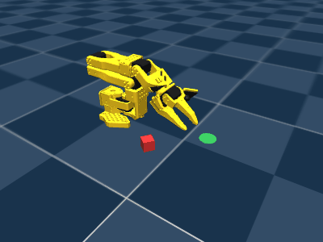

# SO-101 in simulation: the hardware arm, before buying it

The next step for this project is a real arm: the SO-101 (LeRobot's open-source 5-joint arm
with Feetech STS3215 servos, about $250 in parts). This stage builds it in simulation first,
from the MuJoCo Menagerie model (`robotstudio_so101`), with the same discipline as the Franka:
my own kinematics checked against the simulator, then a scripted pick-and-place measured over
100 seeded episodes. Anything that will be a problem on the real arm should show up here first,
where it is free to fix.

Code: `src/ari/so101/` (kinematics, scene, pick-and-place), `scripts/so101_demo.py`,
`tests/test_so101.py`. Numbers: `outputs/so101/demo.json`, `outputs/so101/calibration_and_payload.json`.

## 1. Kinematics: closed form, exact

The SO-101 is not a 7-joint arm, and it needs a different IK. Its joints 2, 3 and 4 (shoulder
lift, elbow, wrist flex) are parallel, and the wrist roll axis passes through the wrist. For a
gripper pointing straight down at a given yaw, that gives a closed-form solution:

1. step back from the tool point along the (vertical) tool axis to the wrist;
2. the base angle points the arm's plane at the wrist (with the 0.2 mm lateral offset);
3. shoulder and elbow are a planar 2-link problem, solved with the law of cosines (two branches);
4. the wrist flex makes the three pitch angles sum to "pointing down";
5. the wrist roll sets the yaw.

Geometry is measured from the model, not typed in: upper arm 116.0 mm, forearm 135.0 mm,
wrist to tool point 159.2 mm, shoulder 116.6 mm above the table.

| Check | Result |
|---|---|
| My FK vs MuJoCo, 500 random postures | max difference 2e-15 m |
| IK position error | 3e-16 m |
| IK: tool pointing down, yaw | exact (errors ~1e-15) |
| Elbow branch | both tried, the first within joint limits is used (the "default" branch violated limits for every table target) |

Reach for a top-down grasp at table height: 70 to 265 mm from the base axis for every yaw
(50 to 285 mm for some), over about ±100° around the base. At 60 mm above the table the band is
100 to 230 mm. The task samples cubes and targets at 120 to 230 mm and ±60°, inside that band.

## 2. Scripted pick-and-place: 100/100

A 25 mm, 20 g cube; min-jerk moves between closed-form IK poses; the gripper closes to its
lower joint limit, so the servo squeezes at its torque limit (2.94 N·m, from the STS3215 model).

## 3. Finding: the one-sided gripper pushes the cube

The Franka's two fingers close symmetrically, so the cube stays where it was. The SO-101 has a
**fixed jaw and one moving jaw**. Closing sweeps the cube across until it hits the fixed jaw:
it moved **9.8 mm** (median over 100 episodes) at every grasp. The placement error inherits it.

The fix is a calibration, like a TCP calibration on real hardware: one uncompensated episode
measures two offsets in the tool frame.

- **held**: where a lifted cube sits relative to the tool point: 9.7 mm toward the fixed jaw.
- **after release**: where the cube ends up once it is set down and the jaw opens: 5.5 mm.
  Not the same: the squeezed cube springs back about 4 mm when the moving jaw lets go. A first
  version that used the held offset for placing was no better than no compensation at all.

Then the gripper is aimed at where the jaws will hold the cube, and the place point is shifted
by the after-release offset. Aiming at the *full* held offset brings the fixed jaw down onto the
cube instead of beside it: 0 of 40 lifted. Leaving a clearance fixes that; 4 mm was the best of 0 to 6 mm.

| 100 episodes | Success | Placement error median | 95th pct | Max | Cube pushed at grasp |
|---|---|---|---|---|---|
| No compensation | 100/100 | 5.6 mm | 7.9 mm | 9.3 mm | 9.8 mm |
| Calibrated (one episode) | 100/100 | **2.0 mm** | **4.1 mm** | 11.3 mm | 4.3 mm |

The one 11.3 mm episode is an outlier I have not explained yet.

## 4. Payload (simulation is optimistic)

Same task, heavier cube, 10 episodes each: 1 kg 10/10, 2 kg 1/10, 3 kg 0/10. The simulated servo
is an ideal position controller with a torque limit. The real one has gear backlash, heats up,
and its torque falls with voltage, and the real jaw holds by friction on printed plastic. Expect
far less: treat this as an upper bound, and measure.

## 5. What to measure on the real arm (and what it plugs into)

The point of building it in simulation is to know what to check first, and where each number goes.

| Measure on hardware | How | Plugs into |
|---|---|---|
| Joint zero offsets (calibration) | LeRobot calibration; then touch the tool to 4-5 marked points | FK/IK geometry (`measure_geometry`) |
| Command-to-motion latency | log commanded vs read position, step input | Stage 7 latency sweep: is it under 200 ms, where the policies hold? |
| Backlash per joint | reverse direction, read encoder vs a dial or camera | repeatability; Stage 7 sensing-offset sweep |
| Gripper push and spring-back | grasp a cube on a marked grid, photograph before/after | `GripperCalibration` (here: 9.7 and 5.5 mm) |
| Grip force / payload | hang weights until it slips | section 4's upper bound |
| Camera to base transform | a printed marker at a known pose | Stage 3 perception, camera loop |

Prediction to check: with calibration, the real arm should place within about 5 mm median
(simulation: 2.0 mm, plus backlash and calibration error). If it is much worse, latency or
backlash is the first suspect, and the Stage 7 benchmark says which policies tolerate it.

## Limits

- The servo is modelled as an ideal position actuator with a torque limit: no backlash,
  deadband, heating or voltage sag.
- Top-down grasps only. The 5-joint arm cannot reach arbitrary orientations; side grasps would
  need a different (numerical) IK.
- The learned policies (Stages 4-6) were trained on the Franka and are not ported yet.
