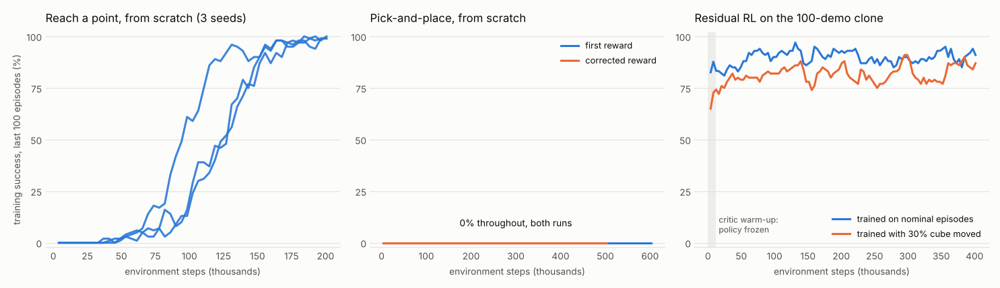

# Stage 5 results: reinforcement learning

PPO written from scratch (`rl/ppo.py`), trained on 2 CPU cores. Training episodes use seeds
30000+; every evaluation row is the mean action (no exploration noise) on the fixed seeds 0-99.
Stage 5 uses a faster action executor (IK once per decision, joint-space interpolation);
baselines were re-measured under it and are marked "ji". State-based observations throughout.

Reproduce: `scripts/train_rl.py` (see its docstring), `scripts/evaluate_bc.py --joint-interp`,
`scripts/plot_rl.py`.

## 0. Is the PPO implementation correct?
| Check | Result |
|---|---|
| Gymnasium Pendulum-v1 (standard benchmark), 150k steps | mean return about −1100 → about −200 |
| Toy 1-D task (in the test suite) | success < 70% → > 90% in 24k steps |
| GAE against a hand calculation; shaping telescopes; Gymnasium `check_env` on both robot envs | pass |

## 1. Reach a random point, from scratch (M16, M17)

| | Success (100 eval episodes) | Median steps to reach | Environment steps to 90% training success |
|---|---|---|---|
| PPO, seed 0 | 100% | 30.5 | 127k |
| PPO, seed 1 | 100% | 30 | 152k |
| PPO, seed 2 | 100% | 31 | 156k |
| Proportional controller (3 lines of code) | 100% | 30 | 0 |

RL learns reaching reliably in about 3.5 minutes and ends up exactly as good as the classical
controller, not better. For a task with a known solution, RL is an expensive way to rediscover it.

## 2. Pick-and-place, from scratch (M17): did not work

| Run | Steps | Success | Cube ever lifted | Closest approach to the cube (mean, training) |
|---|---|---|---|---|
| First reward | 600k | 0% (0-3.7) | never | about 30 cm (from 52 cm at the start) |
| Corrected reward (non-negative potential) | 500k | 0% (0-3.7) | never | 47 cm → 34 cm |

The policy does not even reach the cube, which the reach experiment shows PPO can do in
150k steps. One reward flaw was found and fixed between the runs (with γ < 1, standing still earned
`(γ − 1)·Φ` per step, an income wherever Φ was negative, roughly cancelling the time penalty); it
was not the main problem. **Why the approach is not learned here is not established.** Untested
candidates: 300-step episodes dilute credit compared with 80; the extra yaw and gripper dimensions
add exploration noise; reward scale relative to the value-function error. Grasping from scratch
would in any case require discovering "align, descend, close, lift" by chance.
The "push" step of the original curriculum (reach → push → pick) was not attempted.

## 3. Residual RL on the cloned policy (M18)

Base: the 100-demonstration clone from Stage 4, frozen. PPO learns a correction that starts at
zero. 400k environment steps (about 2,600 episodes, 11 minutes).

| Policy | Nominal | Cube moved | Median time | Median placement error |
|---|---|---|---|---|
| Clone, 100 demos (ji) | 66% (56.3-74.5) | 43% (33.7-52.8) | 7.1 s | 4.0 mm |
| Clone + exploration noise, **no learning** | 79% (70.0-85.8) | 51% (41.3-60.6) | 7.1 s | 4.8 mm |
| Clone + residual RL, seed 0 | **92%** (85.0-95.9) | 69% (59.4-77.2) | 6.8 s | 10.1 mm |
| Clone + residual RL, seed 1 | **93%** (86.3-96.6) | 64% (54.2-72.7) | 6.6 s | 9.2 mm |
| Clone + residual RL, trained with 30% disturbed episodes (`rl_residual.pt`) | 93% (86.3-96.6) | **73%** (63.6-80.7) | 6.8 s | 11.9 mm |
| *Reference: reactive expert (ji)* | *100%* | *100% (Stage 4 executor)* | *6.8 s* | *1.5 mm* |
| *Reference: clone + DAgger, 160 epochs (Stage 4 executor)* | *70%* | *67%* | *6.9 s* | *1.9 mm* |

## What the numbers say

1. **RL improved a policy that imitation had left at 66%, to 92-93%, without an expert.** Two
   training seeds agree on the nominal number.
2. **Half of that is noise, not learning.** The exploration noise alone lifts the clone from 66% to
   79%: jitter frees it from the millimetre-scale stalls diagnosed in M15. The learned part is
   79% → 92-93% nominal and 51% → 64-73% disturbed. Without the noise-only baseline the whole
   26 points would have been credited to RL.
3. **The agent optimized exactly what was rewarded.** Median placement error rose from 4 mm to
   9-12 mm: the reward pays the same anywhere inside the 3 cm zone and charges for time, so
   accuracy was traded for speed and reliability. If precision matters, it has to be in the reward.
4. **Training on disturbances helped less than expected:** 73% vs 64-69% with the cube moved,
   inside the seed-to-seed spread. The residual is limited to about 5 mm of correction per step and
   cannot rewrite what the clone does when the cube jumps 5-10 cm.
5. **Compared with DAgger from the same 100 demonstrations:** residual RL is clearly better on the
   nominal test (92% vs 70%) and similar under disturbance (64-73% vs 67%). DAgger needs an expert
   to answer queries and 300 extra rollouts; RL needs only a reward and about 2,600 rollouts.
6. **Still below the hand-written reactive expert** (100% / 100%). On this task, with full state
   available, classical feedback control remains the best policy in the repository.

## Limitations
- State-based: object poses from the simulator. The image policy (M15) was not fine-tuned with RL.
- Two seeds for the main residual result, one for the disturbed-training variant.
- The residual cannot exceed small corrections by design; fine-tuning all weights was not tried.
- Open-table scene only; Menagerie's default gripper.
- From-scratch pick-and-place failure is not explained (section 2).
