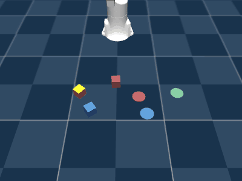

# Stage 6 results: language and task-level autonomy

Scene: three cubes (red, blue, yellow) and three targets (red, blue, green) on the table
(`envs/multi_object.py`). An instruction names one cube and one target; a task is one or two
instructions. Language is generated by a small grammar (`language/grammar.py`: 24 sentence
templates, 45 words). Everything is state-based (object positions from the simulator, not from
the camera) and runs on 2 CPU cores. Demonstration seeds 40000+; evaluation seeds 0-149 (M19)
and 0-99 (M20). An episode succeeds only if the **instructed** cube ends on the **instructed**
target.

Reproduce: `scripts/train_language.py parser`, `scripts/train_language.py policy --seed 2`,
`scripts/evaluate_language.py m19`, `scripts/evaluate_language.py m20`,
`scripts/language_demo.py --seed 7 --faults`.

*"please move the yellow block onto the blue target. after that lift the blue cube and set it on
the green area", with two injected mishaps. The executor checks each result, retries, and
verifies the whole task at the end.*

## 0. What is held out, and a test that did not test anything

Four test splits (`grammar.SPLITS`):

| Split | Sentence templates | (cube, target) pairs |
|---|---|---|
| seen | the 16 training templates | the 7 training pairs |
| new phrasing | 8 templates never trained on, including one unseen verb | training pairs |
| new pairing | training templates | yellow→green and blue→blue, never trained on |
| order only | training templates | red→blue and blue→red only |

"Order only" exists because red and blue are the only colours that can be either a cube or a
target, so "red ... blue" can only be read correctly by using word order.

**First design, discarded.** I originally held out blue→red and yellow→green. Both parsers
scored 100% on seen sentences and 48.2% on the new pairing. The cause was the split, not the
models: with blue→red never in training, the words {red, blue} always meant red→blue, so
neither model had any reason to learn word order, and each answered "red→blue" for every
blue→red sentence. A test split must be solvable from the training data in principle; this one
was not. The pairs were changed so that both red→blue and blue→red are trained.

## 1. Instruction parsing (text → cube, target), 3 seeds, 2000 sentences per cell

| Parser | seen | new phrasing | new pairing | order only |
|---|---|---|---|---|
| Bag of words (ignores word order) | 72-85% | 66-71% | 100% | 10-52% |
| GRU (reads the sentence in order) | 100% | 96-99% | 100% | 100% |

The bag-of-words model cannot tell "red on blue" from "blue on red" and is at or below chance
there, as it must be. The GRU's remaining errors are all on unseen templates.

## 2. Following one instruction (M19), 150 episodes per row

Two designs. **Modular:** the GRU parser picks the cube and target, a Stage 4 skill moves.
**End-to-end:** one network takes the sentence and the scene and outputs actions
(`language/policy.py`). It is trained by behaviour cloning only (500 demonstrations, no label
saying which object a sentence means), so it must discover the grounding from what the expert
did. Its attention over the objects can be read out, which is what makes the failure analysis
below possible.

| System | seen (n=50) | new phrasing (n=50) | new pairing (n=50) | Total |
|---|---|---|---|---|
| Told the right objects + reactive expert (upper bound) | 100% | 100% | 100% | 150 |
| **Modular: GRU parser + Stage 4 learned skill** | 100% (93-100) | 98% (90-100) | 100% (93-100) | **149** |
| End-to-end, seed 0 | 88% (76-94) | 80% (67-89) | 48% (35-61) | 108 |
| End-to-end, seed 1 | 100% | 100% | 88% (76-94) | 144 |
| **End-to-end, seed 2** (shipped as `language_policy.pt`) | 100% (93-100) | 96% (87-99) | 96% (87-99) | **146** |
| End-to-end, text encoder started from the parser, seed 0 | 0% | 2% | 2% | 2 |
| End-to-end, text encoder started from the parser, seed 1 | 100% | 96% | 100% | 148 |

95% confidence intervals in brackets. The shipped model is the from-scratch seed with the lowest
validation error (seed 2: 0.0009, seed 1: 0.0011, seed 0: 0.0150), a rule that does not use
these episodes; `train_language.py policy --seed 2` reproduces it.

**The headline is the spread, not any single row.** The same code and data give 108, 144 and
146 of 150 from three seeds, and 2 or 148 with a pretrained text encoder. The modular system has
no such lottery in what was measured: all three parser seeds read word order perfectly
(section 1).

### Why a run fails: grounding or motion

| Run | Wrong cube or target (all fail) | Right objects, motion failed |
|---|---|---|
| seed 0 | 19 | 23 |
| seed 1 | 6 | 0 |
| seed 2 | 4 | 0 |
| pretrained text, seed 0 | 148 | 2 (of the 2 grounded) |
| pretrained text, seed 1 | 2 | 0 |

What each run gets wrong (1000 generated sentences per split, plus every template × pair):

- seed 0: blue→blue (never trained) and red→blue in target-first sentences such as "on the
  blue target put the red cube", read as blue→red every time although that sentence form and
  pair are in the training data.
- seed 1: almost only blue→blue, mostly in target-first sentences. Word order is otherwise
  learned (100% on the order-only split).
- seed 2: yellow→green in one template and red→blue in one unseen template.

Motion: seed 0's failures with the right objects are missed grasps and stalls beside the cube
(the cube was never lifted in 9 of 10 inspected episodes), the usual signature of an imprecise
clone (Stages 4 and 5).

### A conclusion I drew too early, and what replaced it

From seed 0 alone I wrote: "learning word order from actions is much harder than from labels;
the end-to-end policy loses to the modular one by 41 episodes." Two more seeds read word order
perfectly and lose by 3 to 5 episodes. The claim was about one training run. What the seven
runs do support:

**1. A run's grounding is decided in the first epoch.** Share of validation sentences with
attention on both instructed objects:

| Run | After epoch 1 | After epoch 60 |
|---|---|---|
| seed 0 | 95.9% | 96.4% |
| seed 1 | 100% | 100% |
| seed 2 | 97.8% | 100% (reached at epoch 5) |
| pretrained text, seed 0 | 0% | 0% |
| pretrained text, seed 1 | 100% | 100% |

In the from-scratch runs the attention saturates (weight 1.000 on one object), and a saturated
softmax passes almost no gradient, so an early commitment is kept. In the pretrained seed-0 run
the cube attention is right and the target attention is a consistent wrong assignment (said
"blue" → green, said "green" → red). It is less sharp there (mean weight 0.82) and still never
recovered; why it stays is not established.

**2. Slowing the language side down fixed the pretrained failure, in the one case tried.**
Same seed 0, learning rate of the text encoder and attention ×0.1 (`--attention-lr-scale 0.1`):

| Run (seed 0) | Grounding after epoch 1 | M19 total | Wrong grounding | Motion failures |
|---|---|---|---|---|
| pretrained text | 0% | 2 | 148 | |
| pretrained text, attention learning rate ×0.1 | 100% | **148** | 0 | 2 |
| from scratch | 95.9% | 108 | 19 | 23 |
| from scratch, attention learning rate ×0.1 | 90.4% | 124 | 7 | 19 |

This supports "the pretrained encoder lets the attention commit before the motion network
knows what the target is for" for that run. It is one comparison on one seed, and the same
change did not cure the from-scratch seed 0, so it is not a general fix and not a proven
mechanism.

**3. Imperfect grounding goes together with poor motion.** The two runs that ended at 96%
grounding have 23 and 19 motion failures; the four that reached 100% have 0 to 2, including one
with the same seed, data split and motion-network initialization. Their motion error on
validation data, given the true objects, differs only by a factor of about 1.4 (0.0014-0.0015
against 0.0009-0.0012), which repeats Stage 4's lesson that small differences in imitation
error become large differences in grasp success. A plausible reading is that 4% of training
samples fed the motion network the wrong object. Not tested directly.

**4. Pretraining the text encoder helps when it does not lock in wrongly.** Both grounded
pretrained runs score 148 and get every new pairing right, including blue→blue, which two of
three from-scratch seeds partly miss.

An earlier attempt at the pretrained failure is kept in the code because it helped elsewhere:
the pretrained sentence vector was larger (norm 9.2 against 2.6) and the initial attention put
0.88 of its weight on one object (0.67 from scratch). Normalizing the sentence vector and
shrinking the initial query weights brought that to 0.40 and raised from-scratch seed 0 from
93.5% to 96.4% grounding; the pretrained seed 0 stayed at 0%.

Not investigated: the 2 episodes of the failed pretrained run in which the instructed cube
ended on the instructed target although the attention pointed at another target.

## 3. Two-step tasks with a planner (M20), 100 tasks

Pipeline: split the text into clauses → parse each → **validate the plan against the scene
before moving** → run a skill per step → check the post-condition (is that cube on that target,
measured) → retry up to 3 times → verify the whole task at the end and repair.

### Understanding and refusals

The plan matched the intended task in 98 of 100. Validation refused 5 tasks without moving:

| Seeds | Parse | Why refused | Verdict |
|---|---|---|---|
| 37, 44 | wrong | low confidence, and the misread target would already be occupied | correct refusal |
| 41, 67, 79 | right | confidence below 0.8 | over-cautious |

No misunderstood instruction was executed. The price was 3 correct plans refused. All 5 are on
sentence templates the parser never saw. A refusal counts as a failure in the tables below, so
95% is the ceiling.

### Execution

| Skill and executor | No faults | Faults injected | Faulted tasks completed (of 60) | Skill runs per task (faults) | Simulated time (faults) |
|---|---|---|---|---|---|
| Scripted (open-loop), no monitoring | 95% (89-98) | 35% (26-45) | 0 | 1.90 | 27 s |
| Scripted + monitoring | 95% (89-98) | 95% (89-98) | 60 | 2.78 | 37 s |
| Learned skill (Stage 4 DAgger clone), no monitoring | 92% (85-96) | 45% (36-55) | 11 | 1.90 | 21 s |
| Learned skill + monitoring | 92% (85-96) | 60% (50-69) | 26 | 2.86 | 34 s |
| **Learned skill + monitoring + reactive fallback** | 95% (89-98) | 95% (89-98) | 60 | 2.54 | 26 s |
| Reactive expert + monitoring | 95% (89-98) | 95% (89-98) | 60 | 2.21 | 20 s |

Skill runs and time are averaged over all 100 tasks (a refused task counts as 0). Faults: with
probability 0.3 per step the cube is knocked out of the gripper mid-carry, and
with probability 0.3 a cube that was already placed is moved 6-10 cm off its target afterwards.

- **Monitoring is what makes the task robust, not the skill.** Without it, no faulted task is
  completed by the open-loop skill. With it, every one is.
- **A learned skill should not be retried outside its training conditions.** The cloned skill
  with monitoring recovers under half of the faulted tasks: after a fault the cube lies somewhere
  the skill never saw during training (for example 6 cm from a target), and it fails there
  repeatedly. Using the learned skill first and a classical skill for retries recovers all of
  them.
- Monitoring does not change the result when nothing goes wrong.
- A scene constraint surfaced the same way: the learned skill failed in scenes where a cube
  started 9-10 cm from a target, closer than the 12 cm minimum of its training data. The
  multi-object scene now enforces 12 cm.

## 4. Vision-language-action models (M21): not attempted

Fine-tuning a pretrained VLA (OpenVLA, SmolVLA, π0-class) needs a GPU and downloadable
pretrained weights; this stage was built on 2 CPU cores without access to them. Nothing was
run, so nothing is claimed. What a real attempt needs: image demonstrations in LeRobot format
(Stage 4's recorder writes the right columns; conversion is not done), a GPU with ≥ 16 GB,
and the M19 evaluation above re-used unchanged as the benchmark, with the parser + skill system
as the baseline to beat.

## Limits of these results

- A generated language of 45 words and 24 templates. "New phrasing" means new templates from
  the same grammar, not free human language. None of this shows understanding of English.
- State-based: object positions and colours come from the simulator. Stage 3's perception is
  not connected to the multi-object scene.
- The monitor reads ground truth from the simulator. On a robot it would need perception, and
  would inherit its errors.
- Three seeds for the from-scratch language policy, two for the pretrained variant, one for
  each learning-rate experiment; evaluation intervals are wide at n = 50.
- The demonstrations for the language policy were collected before the 12 cm cube-target
  separation was enforced, so its training scenes are slightly more varied than its test scenes.
- Faults are two scripted kinds. Recovery from them says nothing about faults nobody scripted.
