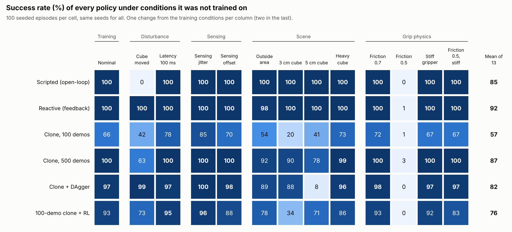

# Stage 7 results: one benchmark for every policy (M22)

Six single-object pick-and-place policies, each run on the same 100 seeded episodes under 13
conditions: 7,800 episodes. A condition changes one thing relative to the scene the learned
policies were trained in (the last column changes two, on purpose). No policy was trained,
tuned or selected on these conditions, with two exceptions stated in the policy table. All
policies act through the same 20 Hz interface and the same executor. Success is the Stage 4
definition: cube resting within 3 cm of the target, gripper open and raised, held 0.5 s,
within 20 s. State-based (object poses from the simulator, with errors added where a condition
says so).

> **Updated 2026-11-17: two flaws this benchmark found are now fixed.** Actions are anchored
> to the pose the policy observed, not the pose when they are applied (finding 4), and the
> reactive policy is told the cube size (finding 2). Neither fix needed retraining: with no
> delay the new interface gives identical episodes, checked seed by seed. The tables show the
> system after the fixes; the numbers from before are kept where they explain a finding, and
> the old behaviour can still be run (`latency_legacy@k`, `reactive#4cm`).

Reproduce: `python scripts/benchmark.py` (main matrix, about 40 min on 2 cores), `--sweeps`,
`--image`, `--extras`; then `python scripts/benchmark_report.py`. Raw per-episode results:
`outputs/benchmark/results.json`.

## Policies

| Policy | How it was obtained | Stage |
|---|---|---|
| Scripted (open-loop) | hand-written; reads the cube pose once, then follows a timed trajectory | 2 |
| Reactive (feedback) | hand-written; re-reads the scene at every step; the teacher of all learned policies | 4 |
| Clone, 100 demos | behaviour cloning of the reactive policy | 4 |
| Clone, 500 demos | behaviour cloning of the reactive policy | 4 |
| Clone + DAgger | 500 demos + 3 DAgger rounds. **Its training included moved cubes**, so "Cube moved" is not new to it | 4 |
| 100-demo clone + RL | residual PPO on the 100-demo clone. **30% of its training episodes had a moved cube** | 5 |

## Conditions

| Condition | What differs from training |
|---|---|
| Nominal | the training conditions |
| Cube moved | cube moved 5-10 cm, 1 s into the episode |
| Latency 100 ms | every action takes effect 100 ms late |
| Sensing jitter | cube position sensed with 2 mm random error at every step |
| Sensing offset | cube position sensed 5 mm off, constant per episode |
| Outside area | cube starts up to 5 cm outside the training area |
| 3 cm cube | 3 cm cube instead of 4 cm |
| 5 cm cube | 5 cm cube instead of 4 cm |
| Heavy cube | cube mass 0.15 kg instead of 0.1 |
| Friction 0.7 | cube friction 0.7 instead of 1.0 |
| Friction 0.5 | cube friction 0.5 instead of 1.0 |
| Stiff gripper | gripper servo 10x stiffer |
| Friction 0.5, stiff | cube friction 0.5 AND gripper servo 10x stiffer |

How hard are the sensing conditions? Stage 3's camera pipeline located the cube with a median
error of 0.3-0.6 mm and a worst case of 2.6 mm under its "poor" noise model. The benchmark's
2 mm jitter and 5 mm offset are therefore well above what that pipeline produces.

## Main matrix

| Policy | Nominal | Cube moved | Latency 100 ms | Sensing jitter | Sensing offset | Outside area | 3 cm cube | 5 cm cube | Heavy cube | Friction 0.7 | Friction 0.5 | Stiff gripper | Friction 0.5, stiff | Mean | Worst |
|---|---|---|---|---|---|---|---|---|---|---|---|---|---|---|---|
| Scripted (open-loop) | 100 | 0 | 100 | 100 | 100 | 100 | 100 | 100 | 100 | 100 | 0 | 100 | 100 | 84.6 | 0 |
| Reactive (feedback) | 100 | 100 | 100 | 100 | 100 | 98 | 100 | 100 | 100 | 100 | 1 | 100 | 100 | 92.2 | 1 |
| Clone, 100 demos | 66 | 42 | 78 | 85 | 70 | 54 | 20 | 41 | 73 | 72 | 1 | 67 | 67 | 56.6 | 1 |
| Clone, 500 demos | 100 | 63 | 100 | 100 | 100 | 92 | 90 | 78 | 99 | 100 | 3 | 100 | 100 | 86.5 | 3 |
| Clone + DAgger | 97 | 99 | 97 | 100 | 98 | 89 | 88 | 8 | 96 | 98 | 0 | 97 | 97 | 81.8 | 0 |
| 100-demo clone + RL | 93 | 73 | 95 | 96 | 88 | 78 | 34 | 71 | 86 | 93 | 0 | 92 | 83 | 75.5 | 0 |

95% confidence intervals at n = 100 are about ±4 points near 97% and ±10 points near 50%;
differences of a few points between cells are not meaningful. The mean is over these 13
conditions only. A different choice of conditions would give different means, so it is a
summary of this table and **not a ranking of the policies**.

## What the benchmark shows

**1. No policy is best everywhere.** After the fixes the reactive policy has the best average
(92.2%), and it still scores 1% at friction 0.5 and 0% beyond 5 mm of sensing jitter (sweeps
below). The 500-demo clone (86.5%) and the scripted policy (84.6%) follow with completely
different failure profiles. The benchmark's value is the profile, not the average.

**2. Hand-written policies fail completely on the one thing they assume; learned policies
degrade a little almost everywhere.**
- Scripted: 0% when the cube is moved (it never looks again). 100% in every other condition
  that the gripper can physically handle.
- Reactive, before the fix: 0% on the 5 cm cube. It had the cube size written in as a
  constant and decided "I am holding the cube" from the finger opening, which a 5 cm cube never
  satisfies. It is now told the size by the scene: 100% on both cube sizes.
- Learned policies never hit exactly 0 for a reason of their own (only for the grip limit
  below), but they lose 5 points or more against their own nominal score in 4 to 8 of the 12
  changed columns. The hand-written policies do so in 1 (reactive) and 2 (scripted).

**3. A clone can outperform its teacher where the teacher has a bug, and DAgger removes that
advantage.** On the 5 cm cube, before the fix, the teacher scored 0%, the 500-demo clone 78%
and the 100-demo clone 41%. The clone learned a softer version of the teacher's rule. The
DAgger policy, corrected toward the teacher on thousands of extra states, scores 8%: it grasps
and lifts the cube and then never releases it (85 of its 92 failures are "still holding"). The
clones were trained on the old teacher, so fixing the teacher does not fix them; that would
need new demonstrations. One comparison, one training seed per policy; the reading "more
faithful imitation inherits more of the teacher's assumptions" fits it but is not tested
beyond it.

**4. Latency broke every learned policy because of the action interface, not the policies.
Fixed.** Before the fix, 100 ms of delay cost every learned policy 26 to 44 points (500-demo
clone 100 → 74, DAgger 97 → 53, RL 93 → 49, 100-demo clone 66 → 39), and at 200 ms even the
hand-written policies collapsed (scripted 11, reactive 44).

The cause: an action was a step relative to the gripper pose measured when the action was
*applied* (Stage 4). A late action was therefore added to a pose the policy never saw, and the
commanded target overshot by however far the arm had travelled during the delay. The fix
anchors each step to the pose the policy *observed* when it computed the action
(`ActionExecutor(interface="observed")`, now the default). With no delay the two are the same
instant, so every trained model works unchanged: the no-delay cells were re-run for five
policy-condition pairs and matched the stored episodes exactly, seed by seed.

Old: steps relative to the pose when the action is applied. Fixed: relative to the pose the policy observed.

| Policy | No delay | 50 ms old | 50 ms fixed | 100 ms old | 100 ms fixed | 150 ms old | 150 ms fixed | 200 ms old | 200 ms fixed |
|---|---|---|---|---|---|---|---|---|---|
| Scripted (open-loop) | 100 | 100 | 100 | 100 | 100 | 100 | 100 | 11 | 100 |
| Reactive (feedback) | 100 | 100 | 100 | 100 | 100 | 100 | 100 | 44 | 100 |
| Clone, 100 demos | 66 | 71 | 77 | 39 | 78 | 10 | 82 | 0 | 83 |
| Clone, 500 demos | 100 | 100 | 100 | 74 | 100 | 27 | 100 | 16 | 99 |
| Clone + DAgger | 97 | 99 | 97 | 53 | 97 | 37 | 97 | 34 | 97 |
| 100-demo clone + RL | 93 | 81 | 94 | 49 | 95 | 23 | 93 | 6 | 93 |

With the fix, up to 200 ms costs no policy anything. Stage 4 chose "relative to the measured
pose" so that teacher and learner would share the servo lag; that argument assumed
measurement and action happen at the same instant, which on real hardware (50-100 ms from
camera to motor is ordinary) they do not.

**What the fix does not do: it makes the arm slower.** Each step is planned from a pose that
is a delay old, so the arm cannot get ahead of what it has seen. The median episode time of
the reactive policy grows from 6.8 s (no delay) to 11.3 s at 100 ms, 15.8 s at 200 ms and
20.4 s at 300 ms. At 300 and 500 ms most episodes hit the 20 s limit mid-task, which is why
the sweep falls to 0-46% there. Given 90 s, the reactive policy and the 500-demo clone
succeed 30 of 30 times at both 300 and 500 ms (`outputs/benchmark/latency_timeout_check.json`).
The old interface failed; the new one is slow. Removing the slowdown would take latency
compensation: predicting where the arm is now from the commands still in flight. Not done.

The 100-demo clone scores higher with any delay and the fixed interface (77-83) than without
delay (66); not investigated. A plausible reading, by analogy with the jitter result below, is
that the delay frees it from millimetre-scale stalls.

**5. The friction column is a hardware limit, not a policy result.** With friction 0.5 every
policy is at 0-3%. Menagerie's gripper presses about 1 N per finger; friction can then hold
2 × 0.5 × 1 N = 1 N against a cube that weighs 0.98 N. The same limit appears with a 0.2 kg
cube at friction 1.0 (0/100 for the reactive policy and for the DAgger clone). With the gripper
servo 10× stiffer, five of six policies return to their nominal level at friction 0.5 (last
column; the RL policy reaches 83 against 93), and the stiff gripper alone changes no policy by more than one point. No amount of learning would
have fixed this; a measurement of grip force did (Stage 2).

**6. More demonstrations generalized better than RL on fewer.** Starting from the 100-demo
clone (mean 56.6), residual RL reaches 75.5; simply cloning from 500 demonstrations reaches
86.5 with no RL at all. RL fixed the weak clone in the conditions it trained in (66 → 93
nominal) and carried its weaknesses elsewhere (3 cm cube: 20 → 34, against 90 for the 500-demo
clone).

**7. Small sensing errors are harmless, and jitter helps a weak policy.** 2 mm of jitter raises
the 100-demo clone from 66% to 85%. Stage 5 found the same effect with action noise (66 → 79):
this clone stalls a few millimetres from the grasp, and any noise shakes it loose. The
benchmark reproduces that finding through a different mechanism.

**8. Starting 5 cm outside the training area** costs the two 500-demo clones 8 points each
(92, 89) and the other two 12 and 15 (54, 78). The hand-written policies do not care (100, 98).

## How far can each perturbation be pushed?

| Sensing jitter (mm) | 0 | 1 | 2 | 5 | 10 |
|---|---|---|---|---|---|
| Scripted (open-loop) | 100 | 100 | 100 | 100 | 88 |
| Reactive (feedback) | 100 | 100 | 100 | 1 | 0 |
| Clone, 100 demos | 66 | 79 | 85 | 89 | 83 |
| Clone, 500 demos | 100 | 100 | 100 | 100 | 97 |
| Clone + DAgger | 97 | 98 | 100 | 100 | 98 |
| 100-demo clone + RL | 93 | 94 | 96 | 91 | 73 |

| Sensing offset (mm) | 0 | 2 | 5 | 10 | 20 |
|---|---|---|---|---|---|
| Scripted (open-loop) | 100 | 100 | 100 | 100 | 68 |
| Reactive (feedback) | 100 | 100 | 100 | 99 | 3 |
| Clone, 100 demos | 66 | 66 | 70 | 65 | 17 |
| Clone, 500 demos | 100 | 99 | 100 | 92 | 19 |
| Clone + DAgger | 97 | 98 | 98 | 88 | 20 |
| 100-demo clone + RL | 93 | 96 | 88 | 81 | 38 |

| Action latency (ms) | 0 | 50 | 100 | 150 | 200 | 300 | 500 |
|---|---|---|---|---|---|---|---|
| Scripted (open-loop) | 100 | 100 | 100 | 100 | 100 | 100 | 100 |
| Reactive (feedback) | 100 | 100 | 100 | 100 | 100 | 45 | 0 |
| Clone, 100 demos | 66 | 77 | 78 | 82 | 83 | 28 | 0 |
| Clone, 500 demos | 100 | 100 | 100 | 100 | 99 | 46 | 0 |
| Clone + DAgger | 97 | 97 | 97 | 97 | 97 | 44 | 0 |
| 100-demo clone + RL | 93 | 94 | 95 | 93 | 93 | 37 | 0 |

- **Jitter: the reactive policy has a cliff between 2 and 5 mm (100% → 1%), and its clones do
  not.** Its rules descend and close only while the measured horizontal error stays within a
  few millimetres; with 5 mm of jitter that almost never holds, and the gripper hovers above
  the cube (96 of 99 failures: never lifted). The 500-demo and DAgger clones, trained on its
  clean demonstrations, stay at 97-100% up to 10 mm. A network that averages over its input
  is more tolerant here than the exact rule it copied.
- **Offset: everything tolerates 5 mm; at 20 mm (half the cube's width) all feedback policies
  fail (3-38%) and the open-loop one keeps 68%.** The scripted policy closes its fingers on
  wherever the cube actually is; the feedback policies keep steering toward a cube that is not
  where they are told.
- **Latency** (fixed interface): flat up to 200 ms for every policy, then the episodes run out
  of time (finding 4). The open-loop scripted policy is unaffected even at 500 ms: its
  trajectory is fixed in time and a delay only shifts it.
- Two of the three sweeps show a clone that is *more* robust than its hand-written teacher
  (jitter here, cube size before the fix in the main matrix).

## Placement precision: the "tighter task" question

The success criterion allows 3 cm. Re-scoring the same nominal episodes with tighter limits:

| Policy | Median error (mm) | 95th percentile (mm) | Within 10 mm (% of all episodes) | Within 5 mm (% of all episodes) |
|---|---|---|---|---|
| Scripted (open-loop) | 1.7 | 2.9 | 100 | 100 |
| Reactive (feedback) | 1.5 | 2.3 | 100 | 100 |
| Clone, 100 demos | 4.0 | 10.7 | 62 | 39 |
| Clone, 500 demos | 1.4 | 3.9 | 99 | 97 |
| Clone + DAgger | 1.6 | 2.7 | 97 | 96 |
| 100-demo clone + RL | 11.9 | 23.7 | 35 | 10 |

The RL policy's 93% at 3 cm becomes 35% at 1 cm and 10% at 5 mm. Its reward was flat inside the
3 cm zone and charged for time (Stage 5), and this is what that bought. The scripted and
reactive policies and the two 500-demo clones would pass a 5 mm task almost unchanged.

## How the policies fail

| Policy | Episodes failed | never lifted | still holding / off table | dropped or misplaced | placed, did not retreat |
|---|---|---|---|---|---|
| Scripted (open-loop) | 200 of 1300 | 200 | 0 | 0 | 0 |
| Reactive (feedback) | 101 of 1300 | 93 | 5 | 2 | 1 |
| Clone, 100 demos | 564 of 1300 | 325 | 169 | 65 | 5 |
| Clone, 500 demos | 175 of 1300 | 126 | 16 | 24 | 9 |
| Clone + DAgger | 236 of 1300 | 112 | 91 | 24 | 9 |
| 100-demo clone + RL | 318 of 1300 | 175 | 20 | 120 | 3 |

The hand-written policies fail in one way (the cube is never lifted: nothing to grasp, or
nothing that can be held). The RL policy's typical failure is different from every other
policy's: it drops or misplaces the cube (120 of its 318 failures), consistent with a policy
that was rewarded for finishing quickly.

## The image policy

| Condition | Success (95% CI) | Failures |
|---|---|---|
| nominal | 42% (33-52) | dropped_or_misplaced 46, placed_but_did_not_retreat 9, never_lifted 3 |
| moved | 4% (2-10) | never_lifted 87, still_holding_or_off_table 2, dropped_or_misplaced 7 |
| outside | 7% (3-14) | never_lifted 70, dropped_or_misplaced 19, still_holding_or_off_table 2, placed_but_did_not_retreat 2 |

The policy that sees only two 64×64 images (Stage 4, M15) was run on three conditions; each
cell renders two cameras per step on CPU and takes about 12 minutes. Its nominal 42% matches
the 43% measured in Stage 4 with the other executor. It does not adapt to a moved cube (4%, as
in Stage 4) and it does not extrapolate: with the cube 5 cm outside the area its 200
demonstrations covered, it lifts the cube in only 30 of 100 episodes and succeeds in 7. The
state-based 500-demo clone loses 8 points in the same condition. A pixel policy has to learn
where things are as well as what to do, and 200 demonstrations at 64×64 did not teach it
positions it had not seen.

## Footnote measurements

| Measurement | Success |
|---|---|
| Reactive policy before the fix (size fixed at 4 cm), 3 cm cube | 100/100 |
| Reactive policy before the fix (size fixed at 4 cm), 5 cm cube | 0/100 |
| Reactive policy, 0.2 kg cube | 0/100 |
| Clone + DAgger, 0.2 kg cube | 0/100 |

## Limits of this benchmark

- One training seed per learned policy. Stage 6 showed how much one seed can mislead; the
  differences between learned policies here (for example DAgger against the 500-demo clone
  on the 5 cm cube) could partly be seed effects.
- 13 conditions chosen by me, one change at a time. Real deployment changes several things at
  once; only one combination was tested.
- The strength of each condition is a choice. The sweeps cover three of them.
- Simulation: the perturbations are models of real effects, not the effects themselves.
  Latency is a pure delay on actions while observations stay current; sensing error is
  Gaussian or constant and applies to the cube position only (not its yaw, not the target).
- State-based. The camera pipeline of Stage 3 is not in the loop.
- Single object, single task. The language-conditioned and planning layers of Stage 6 are not
  part of this matrix.

## Recommendation on the gripper default (open since Stage 2)

Keep the Menagerie default (×1) in the repository so every earlier result stays reproducible,
and use ×10 for any new work. Evidence: the stiff gripper changes no policy's nominal success by
more than one point, removes the friction cliff for all six, and Stage 2 showed it also removes
the drops at high speed. A real Panda grips with roughly 70 N; ×1 is the unrealistic setting.
